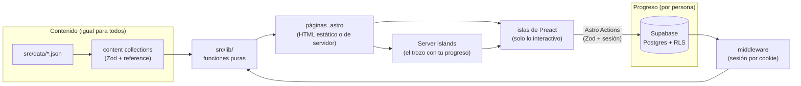

<div align="center">

# Sanssouci

**Un plan de estudio de flauta traversa diseñado como un videojuego.**

Zonas que se desbloquean, jefes que se vencen tocando (y grabando), un árbol de talentos
y una campaña de 90 días, con un temario serio debajo.


</div>

---

## Índice

- [Qué es](#qué-es)
- [El juego en cifras](#el-juego-en-cifras)
- [Características](#características)
- [Stack y por qué](#stack-y-por-qué)
- [Arquitectura](#arquitectura)
- [Empezar](#empezar)
- [Scripts](#scripts)
- [Calidad](#calidad)
- [Seguridad](#seguridad)
- [Estado del proyecto](#estado-del-proyecto)
- [Documentación](#documentación)
- [Créditos y uso](#créditos-y-uso)

## Qué es

Sanssouci organiza el aprendizaje de la flauta traversa desde cero como un juego de rol. Cada **zona** del mapa enseña
lo necesario para la siguiente y termina en un **jefe**: una pieza con condiciones de victoria claras
(tempo con metrónomo, sonido limpio, tomas sin errores) que solo se da por vencida al **grabarla**.
Los **logros** forman un árbol de talentos con requisitos reales, y cada canción del catálogo indica qué
talentos pide antes de empezarla.

El juego organiza el temario; no lo sustituye. Debajo hay siete áreas de estudio en cada zona: lectura,
teoría, respiración, sonido, escalas, estudios y repertorio.

**Honestidad con los tiempos:**
- Los primeros 90 días son un plan con fechas: del 2 de noviembre de 2026 al 30 de enero de 2027.
- A partir de ahí, el camino se mide por **criterios de paso** y estimaciones, no por fechas inventadas.
- Los jefes finales (La Campanella y el Capricho 24 de Paganini) están a años de distancia, y el mapa lo dice.

## El juego en cifras

| | |
|---|---|
| **9** zonas | de la «Pradera del Silencio» a la «Cumbre de Paganini» |
| **10** jefes | cada uno con condiciones de victoria y grabación |
| **61** logros | en 10 ramas: lectura, teoría, oído, respiración, sonido, técnica, escalas, repertorio, hábitos y grabación |
| **124** obras | en 5 rutas: clásica, Ghibli, videojuegos, anime · Vocaloid · J-pop y folk |
| **90** días | 65 sesiones de 45 a 60 minutos, en dos actos (sin flauta y con flauta) |

*Cifras al 2 de noviembre de 2026; crecen al añadir contenido.*

## Características

| Página | Qué hace |
|---|---|
| **Portada** `/` | La sesión de esta noche, los 90 días dibujados como una partitura, la puerta del próximo jefe y las rutas del repertorio. |
| **Mapa** `/mapa` | Un mapa del mundo que se sube de abajo arriba. Las zonas lejanas quedan en niebla y los jefes son puertas que se abren con llaves (logros). |
| **Árbol** `/arbol` | Constelación de talentos con rango de jugador. Muestra la ruta de requisitos al pasar el ratón, filtra «¿Qué puedo hacer ya?» y celebra los desbloqueos. |
| **Zonas** `/niveles/[id]` | Cada zona como una región: minimapa, misiones para pasar, temario, guardián, canciones y misiones secundarias. |
| **Jefes** `/jefes/[id]` | Pantalla de combate: barra de vida (una por condición), video de referencia y el golpe final, que es grabar. |
| **Días** `/dias/[n]` | La misión del día, con cronómetro por etapa (calentamiento → técnica → estudios → repertorio). |
| **Calendario** `/calendario` | «La campaña»: dos actos, una fila por semana y una puerta tras cada jefe. |
| **Canciones** `/canciones` | El repertorio como un mazo de cartas con rareza según la dificultad, cartas bloqueadas y filtros que se guardan en la URL. |
| **Logros** `/logros` | Sala de trofeos: vitrinas por zona, avance por rama y filtro por estado. |
| **Panel** `/panel` | Tu pantalla de personaje con progreso real: racha, rango, sesión de hoy, partitura y próximo jefe. |
| **Entrar** `/entrar` | Entrar con correo y contraseña, crear cuenta o recuperarla. |

Todo el sitio respeta `prefers-reduced-motion`, se maneja con el teclado y funciona primero en el móvil.

## Stack y por qué

| Pieza | Para qué | Por qué |
|---|---|---|
| [Astro 7](https://astro.build) | Páginas y contenido | Genera HTML estático por defecto y solo envía JavaScript donde hace falta («islas»). Las *content collections* validan los datos al compilar. |
| TypeScript (`strict`) | Todo el código | Los esquemas de Zod generan los tipos: un dato mal escrito falla al compilar, no en el navegador. |
| [Tailwind CSS 4](https://tailwindcss.com) | Estilos | Tokens de diseño propios en `src/styles/tokens.css`; sin archivo de configuración. |
| [Preact](https://preactjs.com) + Signals | Partes interactivas | La API de React en 3 KB. Los *signals* comparten estado entre islas (por ejemplo, la vida del jefe y sus golpes). |
| [Motion](https://motion.dev) + [Lenis](https://lenis.darkroom.engineering) | Animación y desplazamiento suave | Animaciones declarativas que se desactivan si el sistema pide menos movimiento. |
| [Supabase](https://supabase.com) | Cuentas y progreso | Postgres con seguridad por filas (RLS), y cuentas con correo y contraseña. |
| [Cloudflare Workers](https://workers.cloudflare.com) | Despliegue | Páginas estáticas en el borde, más un worker para las páginas con sesión. |

Fuentes autoalojadas con [Fontsource](https://fontsource.org): Instrument Serif, Bricolage Grotesque, Martian Mono y Pixelify Sans. Iconos de [Lucide](https://lucide.dev).

## Arquitectura

**Hay dos tipos de datos y cada uno vive en su sitio:**
- **El contenido** (zonas, jefes, logros, canciones, días) es igual para todos. Son archivos JSON versionados en git, que son la fuente de verdad.
- **El progreso** es de cada persona y vive en Supabase.



**Decisiones clave:**
- **Los ids son estables:** la base de datos de progreso los guarda, y un id que no existe rompe el build gracias a `reference()`.
- **Lo derivable no se guarda.** La URL de YouTube sale del id del video. Que una obra sea «reto de oído» se deduce de sus versiones.
- **La lógica vive en funciones puras** (`src/lib/`). Ejemplos: `estadoLogro`, `construirSendero`, `racha`, `rarezaDe`. Las páginas solo componen.
- **Las islas reciben datos planos por props:** nunca importan las colecciones, que solo existen en el servidor.
- **Las páginas con sesión** (`/panel`, `/entrar`, `/perfil`) solo cargan los datos. Un componente de `src/components/cuenta/` los pinta, y así se puede probar con datos de ejemplo.
- **Leer el progreso: Server Islands o página de servidor, según cuánto dependa de quién visita.** Si es solo un trozo (el árbol, el catálogo, la arena del jefe, la misión del día), la página se compila una vez y ese trozo se genera en cada visita (`server:defer`). Si es casi todo (portada, mapa, logros, zonas, calendario), la página entera se genera en el servidor. Sin sesión, todo se ve con el progreso vacío y un aviso para entrar.
- **Escribir el progreso: Astro Actions** (`src/actions/`). Una isla llama a una función del servidor que valida con Zod, exige sesión y comprueba las reglas del juego (no se consigue un logro sin sus requisitos ni se vence a un jefe sin sus llaves).
- **Imágenes optimizadas a mano** (`pnpm optimizar-imagenes`): lo que pinta el servidor no puede transformarlas, así que los archivos ya vienen ligeros (WebP grande y mini).

```
src/
├── data/            contenido del juego (JSON, fuente de verdad)
├── content.config.ts esquemas y relaciones
├── lib/             lógica pura: progreso, mapa, árbol, calendario, catálogo…
├── components/      por dominio: mapa, logros, jefes, canciones, calendario, sesion, cuenta, ui, layout
├── pages/           rutas del sitio (y /auth para la sesión)
├── actions/         Astro Actions: lo que escribe el progreso
├── middleware.ts    sesión de Supabase y rutas privadas
├── config/          nombre del sitio, navegación, horario e imágenes
└── styles/          tokens de diseño y estilos globales
supabase/migrations/ esquema de la base de datos (SQL versionado)
imagenes-originales/ imágenes tal cual llegaron (de aquí sale src/assets/imagenes/)
scripts/             verificar datos, generar documentos, auditar accesibilidad, optimizar imágenes
docs/                plan, catálogo, arquitectura y hoja de ruta
```

Convenciones completas en [`docs/arquitectura.md`](docs/arquitectura.md).

## Empezar

**Requisitos:** Node.js ≥ 22.23.4 y [pnpm](https://pnpm.io).

```sh
git clone https://github.com/yue-codes/sanssouci.git
cd sanssouci
pnpm install
cp .env.example .env   # y rellena las dos variables de Supabase
pnpm dev               # http://localhost:4321
```

Las dos variables son **obligatorias**: el esquema de `astro.config.mjs` (`astro:env`) las valida y, si faltan o tienen mal formato, el build se detiene con un mensaje claro. Así un error de configuración aparece al compilar, no en producción.
Cómo crear el proyecto y aplicar las migraciones: [`docs/supabase.md`](docs/supabase.md).

## Scripts

| Comando | Qué hace |
|---|---|
| `pnpm dev` | Servidor de desarrollo |
| `pnpm build` | Compila el sitio en `dist/`; es la verificación principal |
| `pnpm astro check` | Tipos, y validación de cada JSON contra su esquema (incluidas las referencias rotas) |
| `pnpm verificar` | Reglas entre archivos que un esquema no ve: videos únicos, 90 días, 65 sesiones de 45–60 min, descansos, jefe ↔ zona |
| `pnpm auditar` | Compila y revisa la accesibilidad del HTML generado |
| `pnpm optimizar-imagenes` | Genera `src/assets/imagenes/` (WebP grande y mini) desde `imagenes-originales/` |
| `pnpm generar-docs` | Regenera `docs/mapa.md`, `docs/catalogo.md` y `docs/plan-90-dias.md` desde los JSON |

## Calidad

El proyecto se verifica en tres capas, de lo más barato a lo más completo:

1. **Esquemas (Zod).** Cada JSON se valida al compilar, y una referencia a un id inexistente rompe el build.
2. **Reglas de negocio** (`pnpm verificar`). Revisa lo que cruza archivos, como que cada video aparezca una sola vez o que el plan tenga 90 días con su horario.
3. **Accesibilidad** (`pnpm auditar`). Revisa encabezados, textos alternativos, etiquetas de formulario y atributos `aria` en las 239 páginas generadas.

**Convenciones del código:**
- Cada archivo tiene una cabecera que explica qué es, y todo lo exportado lleva JSDoc.
- Imports con el alias `@/`.
- Componentes pequeños y organizados por dominio.

## Seguridad

- **Seguridad por filas (RLS) en todas las tablas:** cada persona solo puede leer y escribir su propio progreso. Cada migración activa RLS y declara sus reglas explícitamente.
- **Solo se usa la clave *publishable* de Supabase.** Es pública por diseño, porque la protección la ponen las reglas de la base de datos. La clave *secret* no existe en el proyecto.
- **Las credenciales** viven en `.env` (fuera de git) y en los secretos de Cloudflare. La plantilla es [`.env.example`](.env.example).
- **La sesión** va en cookies gestionadas en el servidor (`@supabase/ssr`). Las rutas privadas las protege el middleware.
- **Toda escritura se valida en el servidor** (Zod en cada Action y en `/perfil`), aunque el formulario ya valide: cualquiera puede mandar una petición sin pasar por él.
- **Lo que depende de quién visita no se guarda en caché:** cada Server Island responde con `Cache-Control: private, no-store`.

## Estado del proyecto

| Fase | Estado |
|---|---|
| 1. Datos y esquemas | ✅ |
| 2. Documentos generados | ✅ |
| 3. Web de contenido | ✅ (rediseño «Nocturno» terminado) |
| 4. Cuentas y progreso | ✅ se guardan días, logros, victorias, avance por canción y perfil; todas las páginas leen el progreso real; cuentas con correo y contraseña |
| 5. Despliegue en Cloudflare Workers | ✅ publicada en [sanssouci.eduardo-jes-angeles-hdz.workers.dev](https://sanssouci.eduardo-jes-angeles-hdz.workers.dev) (cada push a `main` publica) |

Los pasos pendientes, con sus decisiones abiertas, están en [`docs/hoja-de-ruta.md`](docs/hoja-de-ruta.md).

## Documentación

| Documento | Contenido |
|---|---|
| [`docs/plan.md`](docs/plan.md) | Reglas del juego, cuidado del cuerpo, guía de la flauta y libros |
| [`docs/mapa.md`](docs/mapa.md) · [`docs/plan-90-dias.md`](docs/plan-90-dias.md) · [`docs/catalogo.md`](docs/catalogo.md) | Generados desde los JSON (no se editan a mano) |
| [`docs/clasificar-cancion.md`](docs/clasificar-cancion.md) | Criterio para añadir una obra al catálogo |
| [`docs/arquitectura.md`](docs/arquitectura.md) | Estructura, convenciones, diseño visual y una nota por página |
| [`docs/supabase.md`](docs/supabase.md) | Configuración de Supabase: autenticación, tablas y migraciones |
| [`docs/diseno-tecnico.md`](docs/diseno-tecnico.md) | El diseño técnico aprobado y las fases |
| [`docs/hoja-de-ruta.md`](docs/hoja-de-ruta.md) | Lo que falta, paso a paso |
| [`CLAUDE.md`](CLAUDE.md) | Contexto y decisiones del proyecto para Claude Code |

## Créditos y uso

Proyecto personal de aprendizaje.

- Las ilustraciones y fotografías de `imagenes-originales/` (y sus versiones en `src/assets/imagenes/`) son de **terceros** y se usan solo de forma privada. Hay que sustituirlas antes de publicar o compartir el sitio.
- Los videos del catálogo pertenecen a sus autores y se enlazan o incrustan desde YouTube.
- *Sanssouci* («sin preocupaciones») es el palacio de Federico el Grande en Potsdam. Federico fue un flautista aficionado de primer nivel y compuso más de cien sonatas para flauta.
